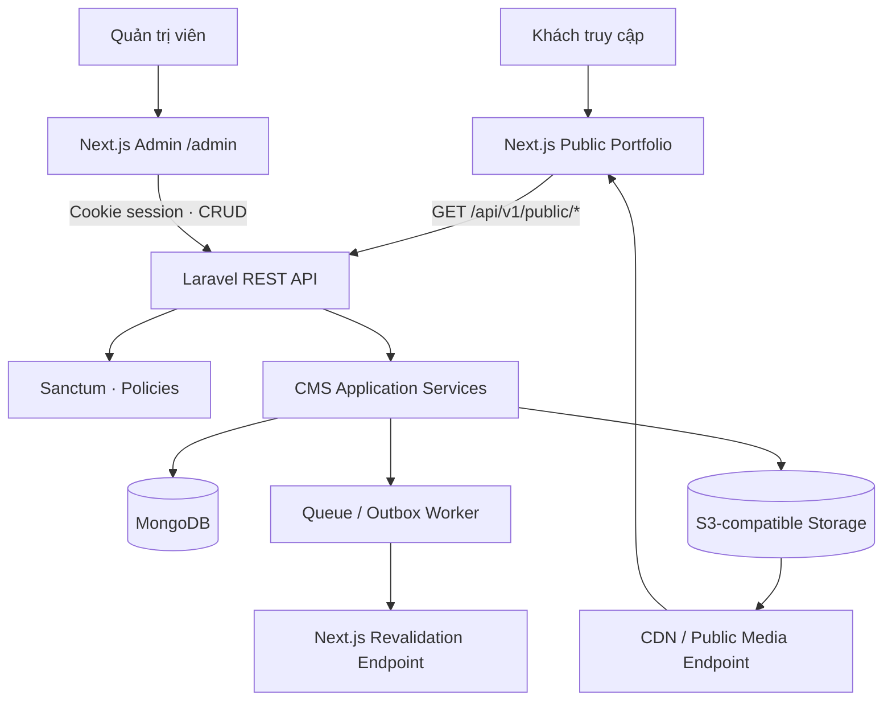
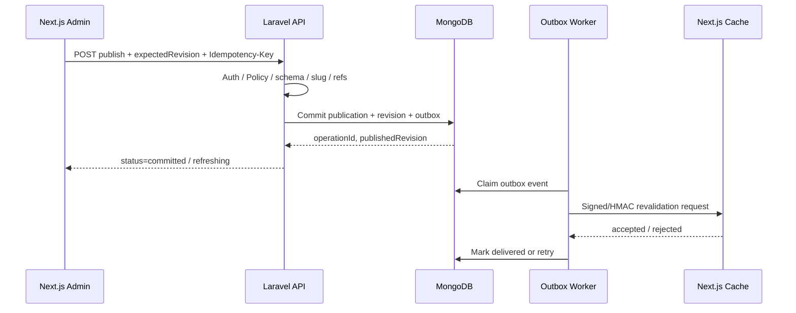

# Portfolio CMS — Laravel Backend Architecture & API Specification

**Phiên bản:** 1.0  
**Ngày:** 17/10/2026  
**Ngôn ngữ tài liệu:** Tiếng Việt  
**Backend:** Laravel 13.x · PHP 8.3+ · REST API · MongoDB · S3-compatible object storage  
**Frontend tiêu thụ API:** Next.js App Router · Tailwind CSS v4 · Admin tại `/admin`  
**Tham chiếu nội bộ:** `modern-neobrutal-portfolio-admin-cms-spec.md` (v1.1), `modern-neobrutal-dev-portfolio-spec.md` (v1.0)

> **Mục tiêu:** Thiết kế backend Laravel độc lập, vận hành một headless JSON CMS cho portfolio developer đa năng. Laravel xử lý xác thực, phân quyền, nội dung, media, revision, publishing và audit; Next.js chỉ là client UI và trình render website. Có **mẫu `.env.example` S3-compatible sẵn để điền thông tin thật** ở phần 5 và file `.env.example` đính kèm. Đây là **architecture/implementation spec**, không cung cấp mã nguồn PHP triển khai.

> **Lưu ý về secrets:** Những giá trị `CHANGE_ME`, hostname `.example` và tên bucket trong ví dụ là placeholder **không thể sử dụng trực tiếp để kết nối dịch vụ thật**. Tuyệt đối không commit `.env`, key S3, MongoDB URI có mật khẩu, APP_KEY hoặc webhook secret.

---

# 0. Quyết định kỹ thuật cần chốt

| Chủ đề | Phương án chọn | Lý do |
|---|---|---|
| Laravel | **13.x**, khóa phiên bản cụ thể bằng Composer lock | Mục tiêu là thế hệ Laravel hiện hành; yêu cầu PHP ≥ 8.3 |
| PHP | **8.3+**, có `ext-mongodb` | Laravel + MongoDB PHP integration cần extension MongoDB |
| API | **REST `/api/v1`**, JSON-only | Tách biệt rõ Next.js UI và Laravel services |
| Database | **MongoDB** qua package `mongodb/laravel-mongodb` | Lưu BSON JSON-like; vẫn có Eloquent/Query Builder ở mức hỗ trợ |
| ORM/data access | Laravel MongoDB models + repository/query services | Không giả định toàn bộ Eloquent SQL hoạt động giống MongoDB |
| CMS data | `cms_entries`, `cms_publications`, `cms_revisions` | **Giữ nguyên contract** của admin spec v1.1 |
| Auth | **Laravel Sanctum SPA cookie/session** | Phù hợp admin first-party tại cùng root domain |
| ACL | Owner / Editor / Viewer thông qua Policies/Gates | Kiểm quyền ở server, không chỉ ẩn nút trên UI |
| Media | Laravel Filesystem `s3` + Flysystem | Hỗ trợ S3, R2, MinIO, Wasabi/Spaces tùy tương thích |
| Binary files | **Không lưu trong MongoDB** | Mongo lưu metadata/ref; binary ở object storage |
| Upload | **Presigned direct upload** khi provider hỗ trợ | Giảm tải băng thông backend; có proxy fallback |
| Preview | **Auth-only draft preview** | Không làm rò nội dung chưa xuất bản |
| Cache | Next.js render/cache + invalidation sau publish | Laravel là source of truth, Next.js chỉ đọc publication |
| Queue/session/cache | Local: file/sync; prod: Redis khuyến nghị | Đơn giản khi phát triển, ổn định khi scale |
| Deployment | Docker cho local; API + queue worker + Mongo replica set/Atlas khi production | Dễ tách tầng và khôi phục |

**Ngoài MVP:** đa tenant, workflow xét duyệt nhiều cấp, comments công khai, hệ thống analytics riêng, email newsletter, localization đa ngôn ngữ đầy đủ và tùy ý upload/execute HTML hoặc script từ CMS.

---

# 1. Kiến trúc tổng thể

## 1.1. System context



### Ranh giới trách nhiệm

- **Next.js Public**: render trang, SEO metadata, tạo URL, quản lý cache hiển thị; chỉ tiêu thụ dữ liệu đã publish.
- **Next.js Admin**: UI nhập liệu, bảng CRUD, page builder, media picker, preview controls; không ghi trực tiếp MongoDB/S3 bằng quyền máy chủ.
- **Laravel API**: validation, business rules, authorization, CRUD, snapshots, slug uniqueness, media policy, auditing, redirects, cache notifications.
- **MongoDB**: source of truth cho dữ liệu CMS, revisions, publications, audit; không lưu file binary lớn.
- **S3-compatible**: object keys và bytes của ảnh, resume, tài liệu; chỉ metadata/asset relations tồn tại ở MongoDB.
- **Redis (tùy theo môi trường)**: sessions, queues, cache/rate-limit. Không dùng Redis như cơ sở dữ liệu CMS chính.

## 1.2. Hostnames và cookie topology

| Môi trường | Next.js (public + admin) | Laravel API | S3 endpoint |
|---|---|---|---|
| Local | `http://localhost:3000` | `http://localhost:8000` | `http://localhost:9000` khi dùng MinIO |
| Production (ví dụ) | `https://example.com` | `https://api.example.com` | Endpoint của nhà cung cấp |
| Media public | `https://cdn.example.com` nếu có | Không bắt buộc qua API | CDN/bucket được cấu hình phù hợp |

- Khuyến nghị **cùng registrable domain** (`example.com` và `api.example.com`) nếu dùng Sanctum SPA cookie.
- Domain admin không phải một ứng dụng PHP riêng; `/admin` thuộc Next.js.
- Không dùng wildcard CORS khi gửi cookies. Chỉ allow origin cụ thể.
- Nếu SSR Next.js cần gọi endpoint admin bằng cookies, phải forward cookies có kiểm soát và xử lý CSRF/session nhất quán; không dùng một service token admin toàn quyền làm đường tắt.

## 1.3. Kiểu kiến trúc backend

Áp dụng **Modular Monolith / Layered Architecture** thay vì microservices. Module độc lập trong một Laravel deploy:

1. Identity & Access
2. Content Schema Registry
3. Entries (draft CRUD)
4. Publishing & Revisions
5. Pages & Blocks
6. Media & S3
7. Globals, Navigation & Redirects
8. Audit, Operations & Notifications
9. Public Delivery API

### Luồng request tiêu chuẩn

`HTTP request → Middleware (session, auth, throttle) → Controller → FormRequest validation → Policy → Application Service → Repository/Storage → API Resource → JSON response`

Controller mỏng, không đặt quy tắc publish và S3 trong controller; repository không quyết định quyền truy cập của người dùng.

---

# 2. Cấu trúc dự án Laravel (đề xuất)

Cây dưới đây mô tả **trách nhiệm thư mục**, không phải code mẫu.

```text
portfolio-cms-api/
├── app/
│   ├── Domain/
│   │   ├── Content/              # Entry, schema registry, reference validation
│   │   ├── Publishing/           # Publish, unpublish, revision, rollback
│   │   ├── Media/                # Asset lifecycle, object key conventions
│   │   ├── Identity/             # Users, roles, permissions
│   │   ├── Pages/                # Page schema + ordered section blocks
│   │   ├── Globals/              # Navigation, socials, site settings
│   │   └── Audit/                # Audit trail + retention
│   ├── Application/
│   │   ├── Commands/             # Create, SaveDraft, Publish, UploadComplete
│   │   ├── Queries/              # SearchEntries, FetchPublicPage
│   │   ├── DTOs/                 # Internal normalized input/output contracts
│   │   └── Services/             # Orchestration and business use cases
│   ├── Infrastructure/
│   │   ├── Persistence/MongoDB/  # Mongo models and repositories
│   │   ├── Storage/S3/           # Laravel Filesystem adapter wrappers
│   │   ├── Cache/                # Cache keys and revalidation transport
│   │   └── Messaging/            # Queue/jobs/outbox
│   ├── Http/
│   │   ├── Controllers/Api/V1/Admin/
│   │   ├── Controllers/Api/V1/Public/
│   │   ├── Requests/
│   │   ├── Resources/
│   │   └── Middleware/
│   ├── Policies/
│   ├── Jobs/
│   ├── Events/
│   └── Listeners/
├── bootstrap/
├── config/
│   ├── database.php             # Mongo connection via env
│   ├── filesystems.php          # S3-compatible config
│   ├── cors.php                 # Cross-origin credentials rules
│   ├── sanctum.php              # SPA stateful origins
│   └── cms.php                  # Custom schemas, feature flags, limits
├── routes/
│   ├── api.php
│   └── web.php
├── database/
│   ├── seeders/
│   └── schema/                 # Idempotent index/validator setup scripts
├── tests/Feature/
├── tests/Unit/
├── .env.example
└── README.md
```

**Giữ mô-đun Domain nhẹ:** đây là portfolio CMS quy mô nhỏ; không cần tạo quá nhiều abstraction/Interface nếu chưa có nhu cầu. Bắt đầu bằng `ContentService`, `PublishService`, `MediaService` và các model có trách nhiệm rõ.

---

# 3. Phụ thuộc và yêu cầu runtime

## 3.1. Runtime và packages

| Thành phần | Yêu cầu |
|---|---|
| PHP | 8.3+ với extension chuẩn Laravel; `ext-mongodb`, `fileinfo`, `openssl`, `mbstring` |
| MongoDB | MongoDB server/Atlas; **replica set** nếu cần transaction nhiều document |
| Composer | Khóa dependencies bằng `composer.lock` |
| MongoDB integration | `mongodb/laravel-mongodb` (bản tương thích Laravel đã chọn) |
| Auth | `laravel/sanctum` |
| Filesystem | `league/flysystem-aws-s3-v3` |
| Redis production (khuyến nghị) | PHP Redis extension hoặc client tương thích |
| Queue worker | Laravel Queue Worker, chạy như process riêng |
| HTTP reverse proxy | Nginx + PHP-FPM hoặc deployment tương đương |

### Ghi chú tích hợp MongoDB

- Cấu hình `DB_CONNECTION=mongodb`, `MONGODB_URI`, `MONGODB_DATABASE` và map chúng trong `config/database.php`.
- Không giả định migrations/indexes của MySQL tự vận hành trên MongoDB. Cần tác vụ bootstrap indexes/validators riêng, có thể chạy lại an toàn.
- Các tính năng Auth, Sessions, Queues nên được **kiểm thử với driver đã chọn**, không mặc định rằng bảng SQL tồn tại; `SESSION_DRIVER=file` và `QUEUE_CONNECTION=sync` đơn giản trong dev.
- Cần cài PHP MongoDB extension ở cả PHP CLI (artisan/worker) và web PHP runtime.

## 3.2. Configuration files cần ánh xạ `.env`

| File | Việc cần cấu hình |
|---|---|
| `config/database.php` | Connection `mongodb` với `dsn=MONGODB_URI`, `database=MONGODB_DATABASE`; default DB connection |
| `config/filesystems.php` | Disk `s3`, key/secret/region/bucket/endpoint/path-style, URL nếu có |
| `config/cors.php` | Allowed origins cụ thể, `supports_credentials=true`, methods/headers phù hợp |
| `config/sanctum.php` | First-party stateful domains/ports |
| `config/session.php` | Session driver, secure cookie, domain, same-site, lifetime |
| `config/cache.php`, `config/queue.php` | Driver local/production |
| `config/cms.php` *(tự tạo)* | Media constraints, public site address, slug, schema version, max blocks, preview timeout |

---

# 4. MongoDB Data Architecture

## 4.1. Collections — **tương thích admin spec v1.1**

| Collection | Dữ liệu | Ghi / đọc |
|---|---|---|
| `cms_entries` | Nội dung biên tập + draft metadata | Admin ghi; không public |
| `cms_publications` | Snapshot công khai an toàn cho renderer | Publish service ghi; public đọc |
| `cms_revisions` | Lịch sử phiên bản immutable | Admin đọc; service ghi |
| `cms_globals` | Cấu hình singleton đang biên tập | Admin ghi |
| `cms_media` | Asset metadata, keys, status, refs | Media service |
| `cms_audit_logs` | Audit events, actor, IP/context tối thiểu | Append-only |
| `cms_redirects` | Slug history, URL migrations | Publish/route service |
| `cms_users` | Identity/admin role metadata | Auth service |
| `cms_outbox` | Revalidation / webhook delivery pending | Worker |
| `cms_sessions` | **Tùy chọn** khi dùng Mongo-backed session | Tránh ở MVP nếu dùng file/Redis |

> `cms_globals` có thể lưu bản nháp cấu hình site; **bản public phải được publish thành snapshot ở `cms_publications`** (ví dụ `type=global`, `key=site`) để tránh public đọc nhầm cài đặt draft.

## 4.2. Entry contract

| Field | Type | Rules |
|---|---|---|
| `_id` | ObjectId | Internal; API truyền ra `id` dạng string |
| `type` | enum | `page`, `project`, `capability`, `skill`, `experience`, `experiment`, `note`, `global` nếu dùng chung |
| `key` | string/null | Stable singleton key như `home`, `about`, `site` |
| `locale` | string | MVP `en` hoặc một locale duy nhất; luôn có giá trị |
| `slug` | string/null | Unique theo **scope route**, lowercase, URL-safe |
| `title` | string | Label cho admin |
| `status` | enum | `draft`, `published`, `archived` (entry lifecycle) |
| `data` | object | JSON-like, whitelist theo type |
| `seo` | object | Title, description, ogMediaId, canonical policy |
| `references` | ID[] | Media/project/skill references |
| `featured`, `sortOrder` | bool/int | Nếu type hỗ trợ |
| `schemaVersion` | int | Migration/renderer compatibility |
| `revision` | int | Optimistic concurrency; tăng khi save |
| `createdBy`, `updatedBy` | ID | Identity reference |
| `createdAt`, `updatedAt` | UTC datetime | ISO8601 string trong HTTP API |
| `publishedAt`, `lastPublishedRevision` | datetime/int nullable | Không cho sửa tùy ý từ form |
| `deletedAt`, `archivedAt` | datetime nullable | Soft delete/archive |

**Published + draft song song:** `status=published` không có nghĩa bản đang sửa đã live; computed flag `hasUnpublishedChanges = revision != lastPublishedRevision`.

## 4.3. Publication contract

| Field | Rules |
|---|---|
| `entryId` | ID entry gốc |
| `type`, `key`, `slug`, `locale` | Public route resolution |
| `publicData`, `publicSeo` | Snapshot đã lọc, không có internal fields |
| `sourceRevision`, `schemaVersion` | Renderer contract |
| `publishedAt` | Thời điểm snapshot active |
| `referencedIds` | Theo dõi dependency invalidation |

**Data publication là bản logic immutable theo source revision:** update publication current phải đi kèm giữ revision history và audit; không sửa publicData trực tiếp từ Admin form.

## 4.4. Revision, Media, Audit, Outbox

- `cms_revisions`: `entryId`, `revision`, `snapshot`, `actorId`, `changeSummary`, `createdAt`; mỗi `(entryId, revision)` unique.
- `cms_media`: `id`, `storageKey`, `disk`, `bucket`, `mimeType`, `size`, `width`, `height`, `alt`, `visibility`, `status`, `checksum`, `uploadedBy`, `createdAt`, `usedByCount` (nếu duy trì được), `deletedAt`.
- `cms_audit_logs`: `actorId`, `event`, `resourceType`, `resourceId`, `requestId`, `metadata` đã loại secrets, `createdAt`.
- `cms_outbox`: `id`, `kind`, `payload`, `status`, `attempts`, `nextAttemptAt`, `lastErrorCode`, `createdAt`; worker xử lý lại idempotent.

## 4.5. Content type / block registry

**Canonical registry kế thừa phần 5.5 của admin spec:**

`announcement`, `hero_poster`, `marquee`, `about_manifesto`, `capability_grid`, `featured_work`, `toolbox`, `journey`, `experiment_grid`, `notes_grid`, `contact_poster`.

Mỗi block: `id`, `type`, `enabled`, `order`, `props`, `references`, `visualVariant`, `schemaVersion`.

**Vấn đề cần thống nhất:** phụ lục 15.2 của admin spec dùng các tên rút gọn như `hero`, `featuredWork`, `capabilityMarquee`. **Backend chọn một canonical naming là tên ở phần 5.5**; frontend thêm mapping alias chỉ để migrate nội dung cũ. Không nhận lẫn lộn hai kiểu khóa trong dữ liệu mới. Giá trị `props` phải theo JSON Schema/form registry rõ ràng, không nhận arbitrary CSS/HTML/script.

## 4.6. Indexing và consistency

| Collection | Index bắt buộc |
|---|---|
| `cms_entries` | unique partial `(type, locale, slug)` khi có route và slug; unique partial `(type, locale, key)` cho singleton; `(type, updatedAt)`; `(type, status, sortOrder)` |
| `cms_publications` | unique partial route key `(type, locale, slug)`; unique partial singleton `(type, locale, key)`; `(type, locale, publishedAt)` |
| `cms_revisions` | unique `(entryId, revision)`; `(entryId, createdAt)` |
| `cms_media` | unique `(disk, bucket, storageKey)`; `(status, createdAt)` |
| `cms_redirects` | unique `(locale, fromPath)`, `(toPath)` optional |
| `cms_outbox` | `(status, nextAttemptAt)`; unique idempotency key theo event |
| `cms_audit_logs` | `(resourceType, resourceId, createdAt)`; `(actorId, createdAt)` |

- Unique cần phản ánh **URL namespace thực**: ví dụ `/work/:slug` và `/notes/:slug` có thể trùng segment; nếu URL chung, uniqueness phải khác.
- Dùng server-side validation + Mongo JSON Schema validator tại database cho trường cốt lõi. Bổ sung optimistic concurrency bằng `revision` trong filter update.
- Luồng ghi nhiều document (publication + revision + outbox) chỉ dựa vào transaction nếu MongoDB deployment hỗ trợ, ví dụ replica set. Khi không có transaction, phải dùng state machine/idempotent recovery, **không** tuyên bố nhiều writes luôn atomic.
- Giữ document dưới giới hạn 16 MiB của MongoDB; không nhúng ảnh/base64 hoặc cả lịch sử revisions vào một entry.

---

# 5. `.env.example` — cấu hình có sẵn cho MongoDB + S3-compatible

**Copy các dòng dưới vào `.env.example`, sao chép thành `.env` khi chạy local.** Nội dung tương tự có sẵn trong file `.env.example` kèm theo tài liệu. Các custom variables (`CMS_*`, `NEXT_*`, `S3_PUBLIC_BASE_URL`, `CORS_ALLOWED_ORIGINS`) **chỉ có hiệu lực khi được map vào Laravel config/service**; đặt biến môi trường thôi chưa tự tạo tính năng.

```dotenv
# ==========================================================
# Laravel app
# ==========================================================
APP_NAME="Portfolio CMS API"
APP_ENV=local
APP_KEY=
APP_DEBUG=true
APP_URL=http://localhost:8000
APP_TIMEZONE=UTC
LOG_CHANNEL=stack
LOG_LEVEL=debug

# ==========================================================
# MongoDB — local Docker / Atlas: replace URI as needed
# ==========================================================
DB_CONNECTION=mongodb
MONGODB_URI="mongodb://127.0.0.1:27017"
MONGODB_DATABASE=portfolio_cms

# ==========================================================
# Laravel Sanctum — local first-party Next.js SPA
# ==========================================================
SESSION_DRIVER=file
SESSION_LIFETIME=120
SESSION_DOMAIN=
SESSION_SECURE_COOKIE=false
SESSION_SAME_SITE=lax
SANCTUM_STATEFUL_DOMAINS=localhost:3000,localhost:8000
CORS_ALLOWED_ORIGINS=http://localhost:3000

# ==========================================================
# Cache / jobs — local defaults; use Redis in production
# ==========================================================
CACHE_STORE=file
QUEUE_CONNECTION=sync
REDIS_CLIENT=phpredis
REDIS_HOST=127.0.0.1
REDIS_PASSWORD=null
REDIS_PORT=6379

# ==========================================================
# S3-compatible object storage (R2 / MinIO / Spaces / S3)
# ==========================================================
FILESYSTEM_DISK=s3
AWS_ACCESS_KEY_ID=CHANGE_ME_S3_ACCESS_KEY
AWS_SECRET_ACCESS_KEY=CHANGE_ME_S3_SECRET_KEY
AWS_DEFAULT_REGION=us-east-1
AWS_BUCKET=CHANGE_ME_BUCKET
AWS_ENDPOINT=https://s3.example-storage.com
AWS_USE_PATH_STYLE_ENDPOINT=false
# Optional public asset domain (application-defined mapping)
S3_PUBLIC_BASE_URL=https://cdn.example.com

# ==========================================================
# CMS configuration — custom settings used by CMS services
# ==========================================================
CMS_DEFAULT_LOCALE=en
CMS_MAX_UPLOAD_MB=15
CMS_PREVIEW_TTL_MINUTES=15
CMS_PUBLIC_BASE_URL=http://localhost:3000
CMS_MEDIA_PRIVATE_PREFIX=private
CMS_MEDIA_PUBLIC_PREFIX=published
CMS_MEDIA_TEMP_PREFIX=tmp
CMS_REVISIONS_RETENTION_DAYS=365

# ==========================================================
# Publish notification -> Next.js server-only endpoint
# ==========================================================
NEXT_REVALIDATE_URL=http://localhost:3000/api/internal/revalidate
NEXT_REVALIDATE_SECRET=CHANGE_ME_RANDOM_64_CHAR_SECRET
NEXT_REVALIDATE_TIMEOUT_SECONDS=5
```

### Quy tắc kiểm tra `.env`

1. Chạy `php artisan key:generate` để tạo `APP_KEY`, **không** tự điền chuỗi dễ đoán.
2. Đổi `MONGODB_URI` theo networking thực tế (trong Docker thường là hostname service Mongo, không phải `127.0.0.1`).
3. Đổi toàn bộ `AWS_*` với credentials chỉ có quyền trên bucket/prefix cần dùng; hạn chế quyền delete/ACL khi có thể.
4. Với nhà cung cấp khác nhau, `AWS_DEFAULT_REGION`, `AWS_ENDPOINT`, `AWS_USE_PATH_STYLE_ENDPOINT` có thể khác. Không có một cấu hình path-style phù hợp mọi provider.
5. `S3_PUBLIC_BASE_URL` **không mặc định là biến Laravel biết dùng**: phải tạo media URL resolver để map biến này; nếu không, có thể dùng `AWS_URL` theo cấu hình disk thực tế.
6. `CORS_ALLOWED_ORIGINS` là biến tùy biến, cần dùng để build `config/cors.php` allowlist; bật `supports_credentials` khi dùng Sanctum SPA session.
7. Nếu dùng `php artisan config:cache`, biến môi trường cần được đọc trong **config files**, không đọc trực tiếp `env()` rải rác trong services.
8. `.env.example` tuyệt đối không chứa secrets thật; `.env` thật cần exclude khỏi git và cấp qua secret manager/runtime env trong production.

## 5.1. Các profile S3-compatible phổ biến

| Provider | `AWS_ENDPOINT` | `AWS_DEFAULT_REGION` | `AWS_USE_PATH_STYLE_ENDPOINT` | Lưu ý |
|---|---|---|---|---|
| AWS S3 | Có thể bỏ trống và dùng AWS endpoint mặc định | Region bucket thật | `false` thông dụng | IAM/role tốt hơn long-lived keys khi deploy AWS |
| Cloudflare R2 | Endpoint tài khoản R2 S3 API | Thường `auto` | Kiểm thử theo endpoint | Custom domain public riêng S3 API endpoint |
| MinIO local | `http://localhost:9000` từ máy host | `us-east-1` thường dùng | `true` | Trong Docker PHP thường là `http://minio:9000` |
| DigitalOcean Spaces | Region endpoint đúng vùng | Region tương ứng | Thường `false` | CDN public domain có thể riêng |
| Khác | Endpoint do provider cấp | Theo provider | Kiểm thử thực tế | Cần thử signed PUT, GET, HEAD, DELETE |

> **Quan trọng với presigned URL:** Nếu Laravel ký URL bằng hostname nội bộ `minio:9000` nhưng browser chỉ truy cập `localhost:9000`, việc thay hostname thủ công có thể làm hỏng chữ ký. Cần một endpoint truy cập nhất quán từ **cả ứng dụng ký và browser**, hoặc chuyển sang proxy upload / public reverse proxy. CORS bucket phải cho phép `PUT`/`GET`/`HEAD` và các headers được ký từ origin của Next.js, không mở wildcard credential tùy tiện.

## 5.2. Production `.env` overrides (hướng dẫn, **không chứa secrets**)

| Variable | Production recommendation |
|---|---|
| `APP_ENV` / `APP_DEBUG` | `production` / `false` |
| `APP_URL` | `https://api.example.com` |
| `MONGODB_URI` | Secret manager / MongoDB Atlas TLS URI |
| `SESSION_DRIVER`, `CACHE_STORE`, `QUEUE_CONNECTION` | `redis`, `redis`, `redis` nếu hạ tầng có Redis |
| `SESSION_DOMAIN` | `.example.com` khi chia sẻ cookie qua subdomain |
| `SESSION_SECURE_COOKIE`, `SESSION_SAME_SITE` | `true`, `lax` cho same-site root domain |
| `SANCTUM_STATEFUL_DOMAINS` | `example.com,api.example.com` (bổ sung ports nếu cần) |
| `CORS_ALLOWED_ORIGINS` | `https://example.com` |
| `FILESYSTEM_DISK` | `s3` |
| `AWS_ENDPOINT`, `AWS_BUCKET`, credentials | Thông tin provider/bucket thật, có kiểm tra connectivity |
| `S3_PUBLIC_BASE_URL` | Public CDN/custom domain thật nếu có |
| `NEXT_REVALIDATE_URL` | HTTPS route private/server-to-server của Next.js |
| `NEXT_REVALIDATE_SECRET` | Random high-entropy secret, lưu server-only |

## 5.3. Phân biệt `.env` và Laravel config thực thi

- `.env` chỉ cung cấp giá trị; việc tích hợp MongoDB, CSRF, CORS, S3 URL resolver, feature flags cần được triển khai tại các config files/module.
- Không dùng `NEXT_PUBLIC_` để expose S3 secret, MongoDB URI hoặc publish webhook secret sang browser.
- Nếu dùng một file `.env` chạy cho nhiều môi trường, sẽ rất dễ nhầm host và keys; nên có `.env.example` chung và secrets/env injection riêng theo môi trường.
- Với Next.js, cấu hình public `NEXT_PUBLIC_API_BASE_URL=https://api.example.com` chỉ nên chứa URL công khai; mọi credential không được chuyển xuống client.

---

# 6. S3-compatible Media Architecture

## 6.1. Quy hoạch file và quyền truy cập

**Không dùng original filename làm object key.** Key phải unique, không đoán được, được tạo bởi backend và không chứa path traversal. Ví dụ:

```text
private/avatars/{uuid}.webp
private/resumes/{uuid}.pdf
tmp/uploads/{uploadId}/{uuid}.jpg
published/projects/{projectId}/{uuid}.webp
published/site/{uuid}.png
```

| Nhóm | Visibility | Access |
|---|---|---|
| `tmp/uploads/*` | private | Signed PUT trong vài phút, cleanup sau timeout |
| `private/*` | private | Signed GET hoặc backend proxy có auth |
| `published/*` | public **chỉ khi phù hợp** | CDN public origin, hoặc signed GET theo policy |

- **Bucket mặc định private** là lựa chọn an toàn. Public serving chỉ mở cho đường dẫn được phép, CDN domain, hoặc copy vào bucket public riêng. Không mở toàn bucket do muốn preview ảnh.
- Không cho upload HTML/SVG có script tùy ý, file thực thi, hoặc MIME giả dạng. Với SVG chỉ dùng khi qua sanitizer đáng tin; MVP ưu tiên JPEG/PNG/WebP/AVIF/PDF với validation phù hợp.
- CV/resume PDF nếu dự định public phải có policy explicit. Nếu tài liệu là private, luôn dùng signed access.

## 6.2. Luồng direct upload có kiểm soát

1. Admin chọn file → UI hiển thị kích thước/định dạng và trạng thái.
2. `POST /api/v1/admin/media/uploads` gửi tên, MIME, size, intended usage; backend kiểm quyền và cấp `uploadId`, object key, presigned PUT URL ngắn hạn, signed headers.
3. Browser PUT trực tiếp đến storage bằng **đúng URL + headers** backend trả về.
4. UI gọi `POST /api/v1/admin/media/uploads/{uploadId}/complete`.
5. Laravel kiểm tra object tồn tại (HEAD), size/MIME thực tế, file signature/metadata, checksum nếu có; quét malware nếu yêu cầu. Trạng thái asset chỉ thành `ready` sau khi kiểm tra hợp lệ.
6. Laravel ghi `cms_media`, trả asset ID và URL an toàn cho preview.
7. Job cleanup xóa upload tạm quá hạn và object mồ côi.

**Fallback:** Nếu provider không hỗ trợ presigned PUT ổn định, dùng API upload proxy có giới hạn dung lượng/timeout, stream trực tiếp S3, không nạp file quá lớn toàn bộ vào RAM.

## 6.3. Download, URL, delete

- Public URL được sinh từ asset resolver dựa trên `disk`, `storageKey`, `visibility`, domain, không lưu một URL chứa signature vĩnh viễn vào CMS.
- Signed URL có thời hạn cho tài nguyên private; không cache/public SEO index URL ký.
- Không xóa file ngay khi editor bỏ chọn; kiểm tra asset có được tham chiếu trong **publication và revisions** không.
- `DELETE /media/{id}` trước hết soft-delete; job purge khi không còn references và qua retention window.
- Media dùng làm OG/social phải có URL ổn định/khả truy cập bởi crawler nếu public.

## 6.4. Upload constraints mặc định

| Thuộc tính | Giá trị khuyến nghị MVP |
|---|---|
| Ảnh | JPEG, PNG, WebP, AVIF |
| Document | PDF; kiểm tra loại file thật |
| Giới hạn ảnh | 15 MiB (có thể điều chỉnh) |
| Giới hạn PDF | 20 MiB, cần config riêng nếu khác ảnh |
| Signed upload TTL | 5 phút |
| Signed private download TTL | 5–15 phút |
| Tên object | UUID/random; tránh original filename |
| Hậu xử lý | Extract dimensions, thumbnail/resize, optimize (worker nếu cần) |
| Alt text | Bắt buộc cho ảnh nội dung, ngoại trừ decorative |

---

# 7. REST API Contracts (`/api/v1`)

## 7.1. Response và lỗi

- JSON response success: `data`, optional `meta`, optional `links`.
- JSON error: `message`, `errorCode`, `errors` theo field, `requestId`; không lộ stack trace hoặc URI nội bộ.
- DateTime dùng ISO 8601 UTC; ID Mongo `_id` xuất ra string `id`; không expose Mongo raw object.
- Pagination: page/limit cho Admin MVP hoặc cursor cho public lists; limit được chặn tối đa.
- Có API version prefix `/api/v1`, giữ tương thích khi schema phát triển.
- Admin mutations có idempotency key ở các thao tác quan trọng như publish/complete upload.

| HTTP | Ý nghĩa |
|---|---|
| `200` | Read/update thành công |
| `201` | Created |
| `202` | Accepted, công việc tiếp tục qua job/queue |
| `204` | No content sau thao tác |
| `400` | Request không hợp lệ ở mức giao thức |
| `401` | Chưa xác thực hoặc session hết hạn |
| `403` | Không có quyền |
| `404` | Không tồn tại hoặc không được công khai |
| `409` | Conflict: slug/revision/idempotency |
| `413` | Vượt file size |
| `422` | Validation/schema/references error |
| `429` | Rate limited |
| `500/503` | Lỗi server hoặc phụ thuộc dịch vụ |

## 7.2. Authentication & account

| Method | Endpoint | Quyền | Chức năng |
|---|---|---|---|
| GET | `/sanctum/csrf-cookie` | Public first-party | Khởi tạo CSRF cookie trước login/mutation |
| POST | `/api/v1/auth/login` | Guest | Login + regenerate session, throttling |
| POST | `/api/v1/auth/logout` | Auth | Logout + invalidate session |
| GET | `/api/v1/auth/me` | Auth | Session user + roles/capabilities |
| PATCH | `/api/v1/auth/profile` | Auth | Cập nhật profile riêng |
| POST | `/api/v1/auth/change-password` | Auth | Đổi mật khẩu, xác nhận mật khẩu cũ |

**MVP single-owner:** Cho phép tạo owner account qua private CLI/seed command, **không** có endpoint đăng ký public. Bật MFA ở giai đoạn hardening khi triển khai thật.

## 7.3. Admin content CRUD

| Method | Endpoint | Mục tiêu |
|---|---|---|
| GET | `/api/v1/admin/content-types` | Registry: types, fields, validation, block presets |
| GET | `/api/v1/admin/entries?type=project&status=draft&q=` | List/filter/pagination |
| POST | `/api/v1/admin/entries` | Create entry + default draft |
| GET | `/api/v1/admin/entries/{id}` | Entry, revision, edit metadata |
| PATCH | `/api/v1/admin/entries/{id}` | Save draft, require expected revision |
| POST | `/api/v1/admin/entries/{id}/archive` | Archive / soft delete |
| POST | `/api/v1/admin/entries/{id}/restore` | Restore archive |
| GET | `/api/v1/admin/entries/{id}/revisions` | Revision history |
| GET | `/api/v1/admin/entries/{id}/revisions/{revision}` | Diff/source snapshot |
| POST | `/api/v1/admin/entries/{id}/restore-revision` | Tạo **draft mới** từ revision cũ |
| POST | `/api/v1/admin/entries/{id}/publish` | Validate/publish by operation ID |
| POST | `/api/v1/admin/entries/{id}/unpublish` | Gỡ bản public, không xóa draft |
| POST | `/api/v1/admin/entries/{id}/preview-session` | Tạo preview session/token ngắn hạn, có auth |
| GET | `/api/v1/admin/entries/{id}/preview-data` | Draft data cho preview, auth-only |

**PATCH contract:** Client gửi `expectedRevision` và changes; server so sánh với latest revision và trả `409` nếu conflict. Không blind-overwrite.

## 7.4. Page builder, globals, redirect

| Method | Endpoint | Mục tiêu |
|---|---|---|
| GET | `/api/v1/admin/pages/{key}` | Load homepage/about/contact page draft |
| PATCH | `/api/v1/admin/pages/{key}` | Save order/blocks theo schema |
| GET | `/api/v1/admin/globals/{key}` | Load global draft |
| PATCH | `/api/v1/admin/globals/{key}` | Update navigation/social/footer/SEO draft |
| GET | `/api/v1/admin/redirects` | List redirects |
| POST | `/api/v1/admin/redirects` | Thêm redirect hợp lệ |
| DELETE | `/api/v1/admin/redirects/{id}` | Xóa redirect không còn cần thiết |

**Nguyên tắc:** Page builder gửi canonical block types + IDs. Global settings **phải publish** mới ảnh hưởng public.

## 7.5. Media

| Method | Endpoint | Mục tiêu |
|---|---|---|
| GET | `/api/v1/admin/media` | Asset list/search/filter |
| POST | `/api/v1/admin/media/uploads` | Issue temporary presigned PUT |
| POST | `/api/v1/admin/media/uploads/{id}/complete` | Validate upload, persist metadata |
| GET | `/api/v1/admin/media/{id}` | Metadata + thumbnail/secure preview |
| PATCH | `/api/v1/admin/media/{id}` | Update alt/caption/tags |
| DELETE | `/api/v1/admin/media/{id}` | Soft delete + dependency check |
| POST | `/api/v1/admin/media/{id}/restore` | Un-delete nếu asset còn bytes |

## 7.6. Public Delivery API (không session, read-only)

| Method | Endpoint | Mục tiêu |
|---|---|---|
| GET | `/api/v1/public/pages/{key}` | Home/About/Contact public snapshot |
| GET | `/api/v1/public/projects` | List projects đã publish |
| GET | `/api/v1/public/projects/{slug}` | Project detail |
| GET | `/api/v1/public/notes` | List published notes |
| GET | `/api/v1/public/notes/{slug}` | Note detail |
| GET | `/api/v1/public/experiments` | Published experiments |
| GET | `/api/v1/public/capabilities` | Public capabilities |
| GET | `/api/v1/public/skills` | Public skills |
| GET | `/api/v1/public/experiences` | Public journey entries |
| GET | `/api/v1/public/globals` | Published site identity/nav/footer/SEO |
| GET | `/api/v1/public/redirects/resolve?path=` | Resolve known redirects nếu Next.js cần |

**Public endpoints không bao giờ:** đọc `cms_entries`, trả revisions, làm lộ admin email nội bộ, secret, bucket credential, signed draft preview hoặc arbitrary query MongoDB.

## 7.7. Operations

| Method | Endpoint | Mục tiêu |
|---|---|---|
| GET | `/up` | Framework liveness probe |
| GET | `/api/v1/admin/system/health` | Readiness: DB, object storage, queue, version; owner only |
| GET | `/api/v1/admin/audit-logs` | Owner xem audit logs |
| GET | `/api/v1/admin/publish-operations` | Trạng thái publish/revalidate |
| POST | `/api/v1/admin/publish-operations/{id}/retry` | Retry outbox/invalidation có kiểm quyền |

---

# 8. Publishing, Revision và Preview — các workflow quan trọng

## 8.1. Save Draft

1. Admin PATCH changes kèm `expectedRevision`.
2. Laravel authenticate, authorize `edit`, validate schema của content type + block registry.
3. Atomic compare-and-set trên `(id, revision)`; tăng revision và cập nhật audit metadata.
4. Ghi revision snapshot theo policy (mỗi save hoặc checkpoint được chốt trước); trả `revision` mới.
5. Nếu đang có public version, website **không đổi**; UI hiển thị `hasUnpublishedChanges`.

## 8.2. Publish (idempotent)



- **Bước publish thành công ở DB không đồng nghĩa cache đã cập nhật.** Trạng thái UI cần phân biệt `published` và `site refresh pending`.
- Dùng outbox để bảo toàn retry. Worker chạy exponential backoff + max retries + dead-letter/manual retry.
- Revalidate những trang bị ảnh hưởng: detail route, listing, home featured, nav/globals, sitemap, RSS nếu có. Invalidate theo dependency mapping được quản lý ở Laravel.
- Với Mongo replica set, có thể dùng transaction để commit các document nội bộ cùng lúc; gọi Next revalidation **sau commit**, không gọi dịch vụ ngoài trong transaction.

## 8.3. Preview Draft

1. User có quyền bấm Preview trong admin.
2. Laravel tạo short-lived preview ticket ràng buộc entry, actor, revision, expiry, single-use hoặc revoke policy.
3. Next.js preview route server-only xác thực ticket qua Laravel; bật noindex/no-store, không expose draft qua public API.
4. Renderer dùng cùng component public nhưng nguồn là draft snapshot đã được validate.
5. Không cho crawl, share public URL không giới hạn hoặc cache nhầm preview.

## 8.4. Unpublish, Restore, Rollback

- Unpublish: gỡ active publication/đánh dấu inactive, giữ revision và audit; revalidate detail + list + sitemap.
- Restore revision: sao chép old snapshot thành **draft mới**, revision tăng, yêu cầu preview và publish lại; không rewrite lịch sử.
- Slug changed: validate target, chuẩn bị redirect cũ → mới, xử lý trùng/circular chains, revalidate cả đường cũ lẫn mới.
- Failure: retry idempotent với operationId, không tạo duplicate revision/redirect.

---

# 9. Authentication, Authorization, Security

## 9.1. Sanctum first-party SPA

1. Browser Next.js gọi Laravel endpoint CSRF cookie, sau đó gửi login.
2. Laravel tạo session trong cookie HttpOnly (cookie session handle), regenerate session khi login.
3. Subsequent admin calls gửi `credentials: include`, cookie và CSRF header theo client request.
4. API xác thực `auth:sanctum`, Policies/Gates trên **từng resource**.
5. Logout invalidate session; rate-limit login và mutations quan trọng.

**Sanctum SPA cookie auth chỉ phù hợp khi frontend/API chia sẻ top-level domain.** Nếu sau này dùng domain khác hẳn, phải thiết kế lại auth (BFF hoặc OAuth/OIDC), không cố ép `SESSION_DOMAIN` vượt ranh giới domain.

## 9.2. Role matrix

| Action | Owner | Editor | Viewer |
|---|---:|---:|---:|
| View Admin / content | ✓ | ✓ | ✓ |
| Create/edit draft | ✓ | ✓ | — |
| Preview draft | ✓ | ✓ | ✓ (nếu được cấp) |
| Upload/manage media | ✓ | ✓ | — |
| Publish/unpublish | ✓ | tùy cấp quyền | — |
| Delete/purge asset | ✓ | — | — |
| Edit users/roles | ✓ | — | — |
| View audit/secrets/security config | ✓ | — | — |

**MVP có thể chỉ tạo Owner**, nhưng Policies được thiết kế trước để không hardcode quyền theo UI.

## 9.3. Security checklist

- [ ] `APP_DEBUG=false` production; HTTPS/HSTS; secure cookies; SameSite policy đúng domain.
- [ ] CORS origin allowlist; bật credentials; không dùng `*` với credentialed requests.
- [ ] CSRF cho session mutations; chống brute-force login, rate limits per user/IP.
- [ ] Không cho client chọn arbitrary collection name, Mongo operator, raw aggregation, file path, storage key, visual HTML/CSS.
- [ ] Schema validation, output sanitization, rich content whitelist, URL protocols (`https`, `mailto` nếu policy cho phép).
- [ ] Access policy từng entry, preview, media; public route chỉ dùng publication repository.
- [ ] Encrypt secrets ở runtime; tránh log password, session, signed URLs, S3 token, URI credentials.
- [ ] Payload size limits, body parsers, pagination cap, upload MIME/magic-byte check, optional malware scan.
- [ ] Policy chống SSRF khi server fetch URL từ nội dung external; không fetch arbitrary user-provided URLs.
- [ ] S3 least-privilege IAM/access keys; bucket private by default; lifecycle cho temp objects.
- [ ] Audit log append-only đối với publish, delete, login sensitive, permissions; backup và restore test.
- [ ] Preview route noindex + no-store; tuyệt đối không dùng public preview token không hết hạn.
- [ ] Revalidation callback có signed/HMAC request + timestamp + nonce/requestId để chống replay; endpoint không public action vô điều kiện.

---

# 10. Caching, Error Handling, Jobs và Observability

## 10.1. Cache contracts

- Laravel public API có thể cache các snapshot đọc nhiều, nhưng **MongoDB publication là source of truth**.
- Next.js quyết định dữ liệu SSR/ISR phù hợp; route detail và homepage phải được invalidated sau publish.
- Stale/revalidation pending phải có trạng thái theo dõi, không báo mọi thứ đồng bộ hoàn tất khi revalidation thất bại.
- Authenticated Admin và draft preview **không dùng shared public cache**.

## 10.2. Jobs / background tasks

| Job | Trigger | Retry policy |
|---|---|---|
| `RevalidateNextSite` | Publish / unpublish / slug update | Retry exponential; audit |
| `OptimizeMedia` | Upload completed | Idempotent per asset |
| `CleanupOrphanUploads` | Scheduler | Delete expired temp only |
| `RecalculateMediaUsage` | Periodic / content change | Repair counts/references |
| `PurgeSoftDeletedMedia` | Retention deadline | Check live + revision references |
| `CheckBrokenReferences` | Scheduler/admin action | Report, not auto-delete content |
| `GenerateExportSnapshot` | Manual backup/export | Store private S3, signed download |

Trong MVP local queue có thể `sync`; khi production nên dùng Redis Queue và worker riêng cho tasks nặng.

## 10.3. Logging & audit

- Structured logs: `requestId`, userId (nếu auth), endpoint/action, status code, duration, contentId, operationId.
- Content text đầy đủ **không** đưa vào audit log; ghi summary/diff metadata; redact PII và secrets.
- Alert: DB unavailable, S3 PUT/GET failure, failed publish, stale outbox, revalidation timeout, storage growth, large 5xx rate.
- Phân biệt `/up` liveness và readiness kiểm tra Mongo/S3/queue (readiness endpoint cần protected và không lộ details cho public).

---

# 11. Deployment & Operations

## 11.1. Local development topology

```text
Docker (local)
├── php-fpm / Laravel API     → localhost:8000
├── MongoDB                  → mongodb:27017 inside Docker
├── S3-compatible MinIO      → localhost:9000 (API), localhost:9001 (Console)
├── Redis (optional)         → redis:6379
└── Queue Worker (optional)  → Laravel artisan queue:work

Next.js (local or Docker)    → localhost:3000
```

**Chú ý hostname:** `.env.example` ở mục 5 mặc định Mongo localhost để dễ cấu hình trên máy host. Khi Laravel chạy trong Docker phải override `MONGODB_URI=mongodb://mongo:27017` theo **tên service thật**; tương tự Redis và MinIO. Không copy nguyên địa chỉ `localhost` vào container rồi kỳ vọng truy cập container khác.

## 11.2. Production topology

```text
Internet
  ├── example.com        → Next.js app (public/admin)
  ├── api.example.com    → Nginx / Laravel PHP-FPM
  └── cdn.example.com    → Public approved media only

Private Network
  ├── MongoDB Atlas or protected replica set
  ├── Redis (sessions/queues/cache)
  ├── Laravel queue workers + scheduler
  └── S3-compatible provider / bucket
```

### Production release sequence

1. Confirm PHP/runtime extensions; composer dependency lock and security checks.
2. Inject environment secrets (do not commit). Verify connectivity to MongoDB and S3.
3. Run idempotent indexes/schema bootstrapping; validate indexes match route rules.
4. Deploy Laravel API, Next.js, queue worker/scheduler.
5. Clear/rebuild Laravel config cache as appropriate; restart workers when code/config changes.
6. Smoke tests: public read, login, draft save, asset upload, preview, publish, cache refresh.
7. Backup snapshot, verify restore procedure on staging.

### Backup policy

- MongoDB snapshots/point-in-time backups as provider supports, including `cms_publications` and `cms_revisions`.
- S3 object versioning (nếu hỗ trợ) + lifecycle policy; backup Mongo alone **không phục hồi ảnh**.
- Restore drill cần chứng minh liên kết metadata ↔ object keys vẫn đúng.
- Không xóa bucket keys mà active publications hoặc revisions đang tham chiếu.

---

# 12. Delivery Plan — backlog theo thứ tự

| Phase | Work package | Deliverable / Done condition |
|---|---|---|
| P0 | Foundation | Laravel repo, PHP ext, Mongo connection, health probe, `.env.example` không chứa secrets |
| P1 | Auth & Policies | Owner login/logout, Sanctum stateful, CORS/CSRF, authorization tests |
| P2 | Data contracts | Models/validators/indexes, schema registry, tests cho Project + Page |
| P3 | Project CRUD | Draft Project CRUD + optimistic revision + Admin integration |
| P4 | Publish pipeline | Snapshot + revisions + outbox + public read + Next cache refresh |
| P5 | Page Builder | `hero_poster`, `featured_work`, reorder/toggle, validation, preview |
| P6 | S3 Media | Presigned upload + complete + media library + asset resolver + cleanup |
| P7 | Content types | Skills, capabilities, experiments, experiences, notes, globals, redirects |
| P8 | Hardening | Redis worker, monitoring, backups, security testing, production release |

**Vertical slice nên làm trước:** Login Owner → tạo Project → Save Draft → Preview → Publish → `GET /public/projects/{slug}` → Next.js hiển thị → sửa Project và xác minh bản public vẫn giữ nguyên cho tới lần publish tiếp theo.

---

# 13. Acceptance Criteria & QA

## 13.1. MongoDB / CMS

- [ ] Tạo/update/read draft Project có `revision`, `schemaVersion`, audit fields.
- [ ] Content form sai schema bị `422`, không lưu dữ liệu hỏng.
- [ ] Hai tab sửa cùng revision: request sau bị `409`, không ghi đè.
- [ ] Slug duplicate đúng route scope bị chặn bằng validation **và** unique index.
- [ ] Public GET không thể đọc draft hoặc archived unpublished.
- [ ] Publish tạo snapshot với `sourceRevision`; sửa draft tiếp không đổi publication.
- [ ] Restore một revision cũ thành draft mới, không làm mất history.
- [ ] Publish bị lỗi revalidation được đánh dấu, có retry idempotent.
- [ ] Slug redirect không tạo vòng lặp; link cũ không dẫn nhầm nội dung.

## 13.2. S3-compatible

- [ ] S3 endpoint + credential test bằng môi trường thật/staging; không chỉ kiểm tra biến `.env` tồn tại.
- [ ] Direct upload hoạt động trên browser với CORS/path-style/headers chính xác.
- [ ] File quá dung lượng hoặc MIME giả bị chặn, trạng thái upload fail rõ.
- [ ] Metadata `cms_media` liên kết object key đúng; object missing không được đánh dấu `ready`.
- [ ] Draft/private media không được truy cập như public asset.
- [ ] Published asset có URL ổn định và render được trong Next.js.
- [ ] Xóa asset còn tham chiếu phải fail hoặc yêu cầu workflow migration có kiểm soát.
- [ ] Cleanup chỉ xóa temp/orphan theo rule; không chạm đến ảnh dùng bởi revisions/publications.

## 13.3. Auth / Operations

- [ ] Request admin chưa đăng nhập trả `401`, không có quyền trả `403`.
- [ ] Session expiry/logout, CSRF failure, brute-force throttling được kiểm thử.
- [ ] CORS credentials chỉ cho origin whitelisted; env production bật secure cookies.
- [ ] Không có secrets trong repo, response, logs hoặc build frontend.
- [ ] PHP web và CLI đều có MongoDB extension.
- [ ] `APP_DEBUG=false` trong production.
- [ ] Next revalidation endpoint từ chối missing/invalid signature và replay.
- [ ] Mongo backup và S3 restore drill thành công trên staging.

---

# 14. Những lựa chọn có thể thay đổi mà không phá kiến trúc

- **MongoDB local vs Atlas:** khác URI/network/backup, contracts giữ nguyên.
- **S3 AWS vs R2 vs MinIO:** khác endpoint/path-style/URL/CORS, phần MediaService giữ cùng interface.
- **Redis vs file/sync:** đổi session/queue/cache bằng env và cấu hình runtime, nhưng production nhiều replicas cần session store chia sẻ.
- **Next.js cache policy:** strategy SSR/ISR/tag version có thể thay đổi; Laravel chỉ gửi invalidation event với route/tag list.
- **Public API caching:** thêm CDN/reverse proxy nếu lưu lượng tăng; không cache draft/admin responses.
- **CMS mở rộng:** thêm content type bằng schema registry, policies và public delivery contract thay vì code mới cho từng trang tĩnh.

---

# 15. Tài liệu kỹ thuật xác nhận

Các tham số package/extension và Laravel deployment tham khảo tài liệu chính thức; những con số retention, TTL, size limit và kiến trúc cụ thể trong spec là **đề xuất thiết kế**, không phải mặc định của framework.

1. [Laravel 13 — MongoDB integration](https://laravel.com/docs/13.x/mongodb): extension MongoDB và connection `MONGODB_URI` / `MONGODB_DATABASE`.
2. [MongoDB — Laravel integration Get Started](https://www.mongodb.com/docs/drivers/php/laravel-mongodb/current/get-started/): Composer package và cấu hình MongoDB.
3. [Laravel 13 — File Storage / S3-compatible](https://laravel.com/docs/13.x/filesystem): `AWS_ENDPOINT`, path-style và presigned uploads.
4. [Laravel 13 — Sanctum](https://laravel.com/docs/13.x/sanctum): first-party SPA cookie auth, stateful domains, CORS/CSRF.
5. [Laravel 13 — Deployment](https://laravel.com/docs/13.x/deployment): PHP 8.3+, config caching, workers, `APP_DEBUG`.
6. [Laravel 13 — Queues](https://laravel.com/docs/13.x/queues): background jobs/worker architecture.

---

## Tóm tắt quyết định cuối

**Chọn Laravel 13 + MongoDB + S3-compatible, vận hành theo modular monolith.** Next.js Admin gọi Laravel REST API; public site chỉ đọc `cms_publications`. Dữ liệu draft, revision, media metadata và audit lưu MongoDB; file upload lên S3 với presigned flow; publishing có outbox để invalidation Next.js retry an toàn. Đây là nền tảng đủ linh hoạt để giữ CMS theo hướng **portfolio developer đa năng**, không khóa nội dung vào một vai trò cố định.
